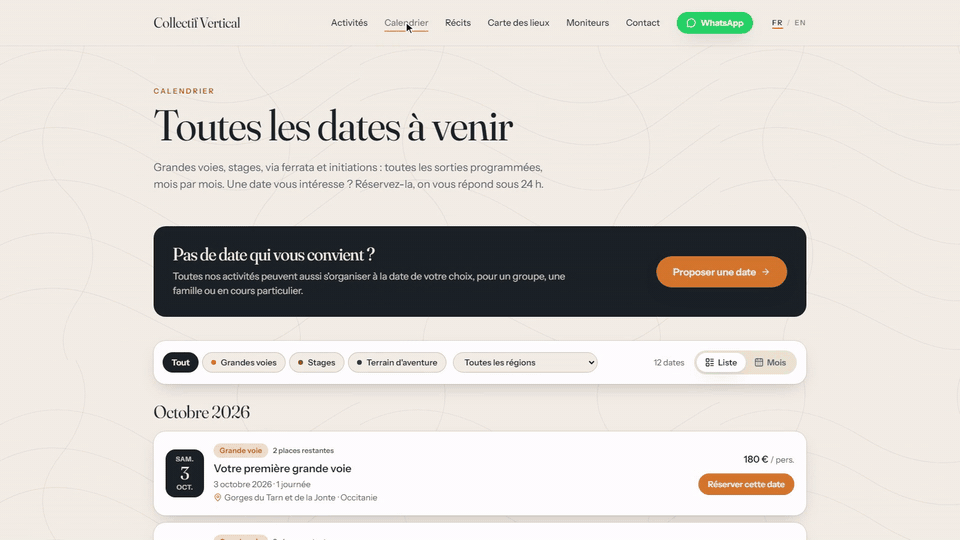

[English](README.md) · **Français**

# Site de moniteurs d'escalade

**Le site public et l'administration d'un collectif de moniteurs d'escalade, que le gérant fait vivre seul, sans toucher au code.** Activités, dates, lieux, chaque libellé, la mise en page et la version anglaise se modifient depuis l'administration.

*Calendrier, puis « Réserver cette date » : le formulaire s'ouvre avec la date déjà choisie. [Vidéo complète (1 min 12)](https://drive.google.com/file/d/1B9oK9wRxfSd5EIXMBbhqnzkp8tGdWlr6/view)*

## Utilisation

- **Activités et calendrier.** Filtres par type, région ou mois ; « Réserver cette date » ouvre le formulaire de demande sur cette date.
- **Carte.** Les lieux sur une carte OpenStreetMap ; chaque marqueur liste les sorties qui s'y déroulent.
- **Administration.** Le gérant modifie les activités (plusieurs tarifs chacune), les dates, les lieux, chaque libellé public, les sections des pages et les menus, avec un aperçu avant publication. Chaque enregistrement rafraîchit les pages concernées.
- **Albums souvenirs.** Après une sortie, les participants reçoivent un lien privé vers les photos et peuvent laisser un avis étoilé, publié après modération.
- **Version anglaise.** Sous `/en` ; chaque section de l'administration a une bascule FR/EN, et un champ anglais vide affiche le texte français.
- **Statistiques.** Visiteurs, pages, provenance, appareils et pays, sans cookie ni adresse IP stockée.

## Architecture

## Exploitation

- **Hébergement.** Vercel pour le site, Supabase (région Paris) pour la base et les photos.
- **État.** En ligne depuis septembre 2026, géré par le client.
- **Technologies.** Next.js 16, React 19, Tailwind CSS, Supabase, Leaflet.

---

**Anthony Hunt** · [ingevision.cloud](https://ingevision.cloud/?p=collectif-vertical) · [LinkedIn](https://www.linkedin.com/in/anthony-hunt-3948a9196) · [GitHub](https://github.com/anthohunt)

Le code et les données du client sont privés.
