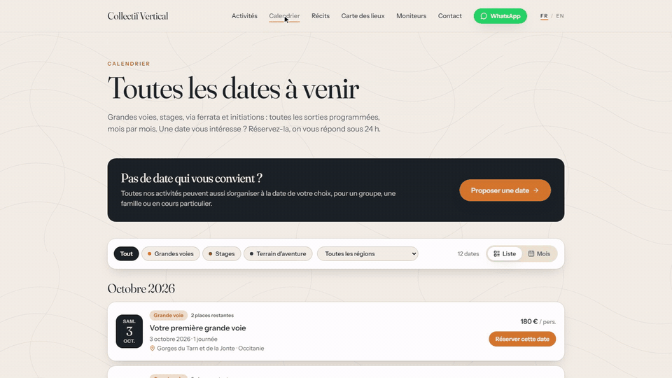
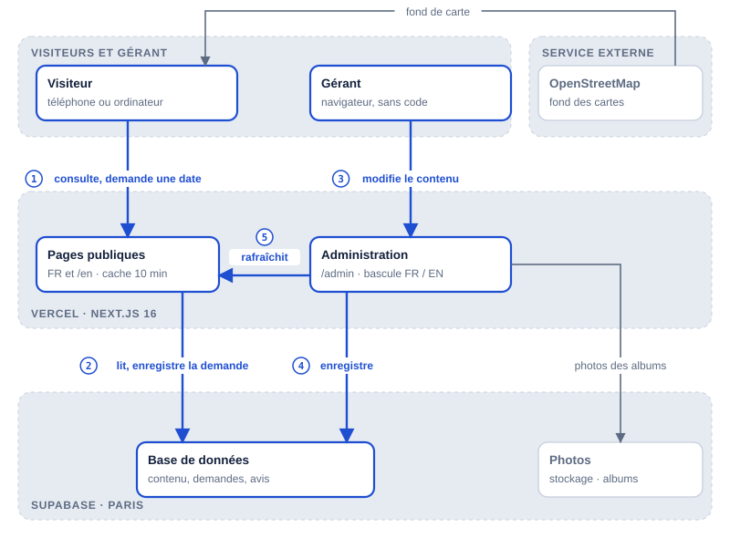

**English** · [Français](README.fr.md)

# Climbing instructors' site

**A climbing instructors' website that its manager runs alone, without touching the code.**

*Calendar, then "Book this date": the form opens with the date already selected. [Full video (1:12)](https://drive.google.com/file/d/1B9oK9wRxfSd5EIXMBbhqnzkp8tGdWlr6/view)*

## Using it

- **Activities and calendar.** Filters by type, region or month; list or month view.
- **Map.** Venues on an OpenStreetMap map; each marker lists the outings held there.
- **Admin.** The manager edits activities (several prices each), dates, venues, every public label, page sections and menus, and previews before publishing. Each save refreshes the affected pages.
- **Souvenir albums.** After an outing, participants get a private link to the photos and can leave a star rating, published after moderation.
- **English version.** Under `/en`; admin sections have a FR/EN toggle (not yet the block editor), and an empty English field shows the French text.
- **Statistics.** Visitors, pages, referrers, devices and countries, with no cookie and no stored IP address.

## Architecture

*Diagram labels are in French.*

## Deployment

- **Hosting.** Vercel for the site, Supabase (Paris region) for the database and photos.
- **Status.** Online since September 2026; the client edits its content.
- **Stack.** Next.js 16, React 19, Tailwind CSS, Leaflet.

---

**Anthony Hunt** · [ingevision.cloud](https://ingevision.cloud/?lang=en&p=collectif-vertical) · [LinkedIn](https://www.linkedin.com/in/anthony-hunt-3948a9196) · [GitHub](https://github.com/anthohunt)

The code and the client's data are private.
